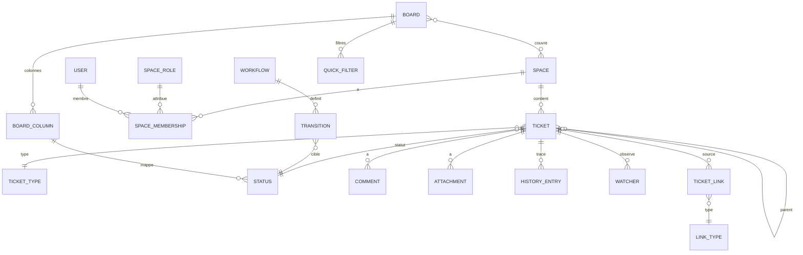

# Fluxo — Spécification fonctionnelle pour Claude Code

## 0. Instructions pour Claude Code
- Lis tout ce document avant d'écrire la moindre ligne de code.
- Commence par proposer un plan d'implémentation par phases (MVP → V1 → V2) avec la stack de la section 13, puis attends sa validation.
- Construis d'abord le MVP, de bout en bout, avec des tests qui couvrent les critères d'acceptation.
- En cas d'ambiguïté, applique l'hypothèse la plus simple et note-la dans un fichier `DECISIONS.md`.
- Le périmètre est volontairement limité à **la gestion de tickets et au board Kanban**. N'ajoute ni sprints, ni roadmap, ni tableaux de bord génériques, ni moteur d'automatisation (voir section 12).

## 1. Contexte et objectif
- **Application de référence** : Jira (Atlassian), un outil de suivi de tickets et de gestion de projet agile. Seule la partie « tickets + board Kanban » est reprise.
- **Objectif** : construire une application originale qui offre ces fonctionnalités tout en corrigeant leurs défauts connus : lenteur, configuration lourde, manques remontés par les utilisateurs.
- **Usage** : **interne**. C'est un outil pour une équipe ou une entreprise, sans inscription publique ni onboarding marketing. L'authentification se fait par identifiant et mot de passe, et c'est un administrateur qui crée les comptes. Une instance correspond à une organisation, auto-hébergeable sous Docker.
- **Nom de code** : **Fluxo**. Ne reprends ni la marque, ni le logo, ni les textes, ni l'identité visuelle de l'original. Le vocabulaire est neutre : *espace* (projet), *ticket*, *board*.
- **Proposition de valeur différenciante** :
  - **Rapide et pilotable au clavier** : chaque action courante prend moins de 200 ms côté UI (mise à jour optimiste) et dispose d'un raccourci. Une palette de commandes est accessible via Ctrl/Cmd+K.
  - **Utilisable par défaut** : le minimum de champs obligatoires, des valeurs par défaut configurables pour tous les champs, des templates de tickets et un board utilisable dès la création de l'espace.
  - **Board plus flexible que l'original** : champs de carte configurables, swimlanes par n'importe quel champ, limites WIP par personne et par cellule, colonnes repliables, et transitions conformes aux règles du workflow.

## 2. Utilisateurs, rôles et permissions

Deux niveaux de rôles : un rôle global, porté par le compte, et un rôle d'espace, porté par l'appartenance à l'espace.

| Rôle | Portée | Description | Peut faire | Ne peut pas faire |
|---|---|---|---|---|
| Administrateur | Global | Gère l'instance | Créer, désactiver et réinitialiser les comptes ; gérer les groupes ; créer et supprimer des espaces ; gérer les types de tickets, priorités, résolutions, types de liens et workflows partagés ; tout ce que fait un admin d'espace, sur tous les espaces | Lire le mot de passe d'un utilisateur |
| Utilisateur | Global | Compte standard | Voir les espaces dont il est membre ; modifier son profil, son mot de passe et ses préférences | Créer un espace (sauf si l'admin l'y autorise via un réglage global) |
| Admin d'espace | Espace | Responsable de l'espace | Gérer les membres et leurs rôles, les boards, colonnes, swimlanes, filtres rapides, composants, versions, labels et le workflow de l'espace (s'il n'est pas partagé) ; supprimer tous les commentaires et toutes les PJ | Modifier un workflow partagé avec d'autres espaces |
| Membre | Espace | Contributeur | Créer, éditer, transitionner, assigner, lier et commenter des tickets ; ajouter des PJ ; supprimer ses propres commentaires et PJ ; gérer les observateurs ; modifications en masse | Configurer le board ou le workflow ; supprimer des tickets (sauf réglage contraire) |
| Lecteur | Espace | Consultation | Voir les tickets et le board, rechercher, observer, commenter (option activable par l'admin d'espace) | Toute modification de ticket |

**Règles** :
- Les permissions fines sont des drapeaux attachés aux rôles d'espace et éditables par l'admin d'espace. Les drapeaux sont : `browse`, `create`, `edit`, `transition`, `assign`, `be_assignable`, `delete`, `link`, `comment_add`, `comment_edit_own`, `comment_edit_all`, `comment_delete_own`, `comment_delete_all`, `attach_add`, `attach_delete_own`, `attach_delete_all`, `manage_watchers`, `bulk_change`, `manage_board`, `manage_versions`, `administer_space`. [Official]
- Les valeurs par défaut des drapeaux correspondent au tableau ci-dessus. [Official]
- Un ticket hors de portée de l'utilisateur n'apparaît jamais : ni dans les recherches, ni sur les boards, ni dans les liens (on affiche alors « ticket restreint »), ni dans les notifications. [Fix]

## 3. Périmètre et priorisation

| Module | Fonctionnalité | Priorité | Origine |
|---|---|---|---|
| Comptes | Connexion identifiant/mot de passe, sessions, admin initial | MVP | [Official] (adapté interne) |
| Comptes | Gestion des comptes et groupes par l'admin | MVP | [Official] |
| Espaces | CRUD espace, clé de ticket, membres et rôles | MVP | [Official] |
| Tickets | Création, édition inline, types, hiérarchie Epic > Standard > Sous-tâche | MVP | [Official] |
| Tickets | Champs système (priorité, assigné, labels, échéance, estimation…) | MVP | [Official] |
| Tickets | Valeurs par défaut configurables pour tous les champs, système compris | MVP | [Requested] 2 798 votes |
| Tickets | Commentaires riches, @mentions, réactions | MVP | [Official] |
| Tickets | Pièces jointes (glisser-déposer, coller une image) | MVP | [Official] |
| Tickets | Observateurs (watchers) | MVP | [Official] |
| Tickets | Historique complet (ancien → nouveau) et onglets d'activité | MVP | [Official] |
| Tickets | Liens entre tickets (types configurables) et liens web | MVP | [Official] |
| Workflow | Statuts, catégories (À faire / En cours / Terminé), transitions, résolution | MVP | [Official] |
| Board | Board Kanban : colonnes ↔ statuts, glisser-déposer, rang | MVP | [Official] |
| Board | Limites WIP min/max par colonne | MVP | [Official] |
| Board | Swimlanes (aucune, assigné, parent, priorité, type, requête) | MVP | [Official] + [Requested] 943 votes |
| Board | Filtres rapides (prédéfinis et personnalisés) | MVP | [Official] |
| Board | Masquage des tickets terminés après N jours | MVP | [Official] + [Fix] |
| Board | Backlog Kanban (À planifier / Sélectionné) | V1 | [Official] |
| Board | Champs de carte configurables (jusqu'à 3 + badges) | MVP | [Requested] 2 462 votes |
| Board | Couleurs de cartes (type, priorité, assigné, requête) | V1 | [Official] |
| Board | Indicateur « jours dans la colonne » qui ignore les jours non ouvrés | V1 | [Official] + [Requested] 473 votes |
| Board | Plusieurs boards par espace, board multi-espaces, board par défaut | V1 | [Requested] 1 739 / 1 897 / 356 votes |
| Board | Colonnes repliables | V1 | [Requested] 380 votes |
| Board | WIP par personne et par cellule swimlane × colonne | V2 | [Requested] 219 / 260 votes |
| Board | WIP partagé entre sous-colonnes | V2 | [Requested] 576 votes |
| Board | Assigner par glisser entre swimlanes d'assignés | V1 | [Requested] |
| Board | Glisser-déposer multiple, support tactile | V1 | [Requested] |
| Board | Glisser vers un statut précis d'une colonne qui en contient plusieurs | V1 | [Requested] 227 votes |
| Recherche | Recherche par filtres visuels + vue liste triable | MVP | [Official] |
| Recherche | Langage de requête textuel (FQL) avec autocomplétion | V1 | [Official] |
| Recherche | Filtres sauvegardés, partagés, favoris | V1 | [Official] |
| Recherche | Abonnement planifié à un filtre (notification ou email) | V2 | [Official] |
| Masse | Modification en masse : éditer, transitionner, déplacer, supprimer, observer | V1 | [Official] |
| Masse | Clonage et liaison en masse | V2 | [Requested] 1 755 / 664 votes |
| Tickets | Clonage avec options (PJ, liens, sous-tâches, commentaires) | V1 | [Requested] 540 votes |
| Tickets | Templates de tickets | V1 | [Requested] 346 votes |
| Tickets | Commentaires épinglés, commentaires en fils | V2 | [Requested] 394 / 696 votes |
| Tickets | Mention de groupes, groupes comme observateurs | V2 | [Requested] 695 / 300 votes |
| Tickets | Labels colorés, renommage et fusion de labels | V1 | [Requested] 470 / 1 111 votes |
| Tickets | Composants, versions (fix version), mise en production d'une version | V1 | [Official] |
| Tickets | Suivi du temps (estimation, temps passé, worklog) | V2 | [Official] |
| Tickets | Champs personnalisés (texte, nombre, date, liste, utilisateur) | V1 | [Official] |
| Workflow | Éditeur de workflow : transitions globales, conditions, validateurs, actions | V1 | [Official] |
| Workflow | Bloquer la clôture si un lien « bloqué par » est ouvert | V1 | [Requested] 519 votes |
| Rapports | Diagramme de flux cumulé (CFD) | V1 | [Official] |
| Rapports | Control chart (cycle time / lead time) | V2 | [Official] |
| Notifications | In-app (cloche) + préférences ; email si SMTP configuré | MVP (in-app) / V1 (email) | [Official] |
| Intégrations | API REST documentée (OpenAPI) + webhooks | V1 | [Official] + [Requested] 430 votes |
| Intégrations | Import et export CSV | V1 | [Official] + [Fix] |
| UX | Raccourcis clavier + palette de commandes | MVP | [Official] + [Requested] |
| UX | Éditeur markdown brut au choix de l'utilisateur | V1 | [Requested] 1 772 votes |
| UX | Temps réel : board et ticket mis à jour sans recharger | V1 | [Fix] |

## 4. Modules fonctionnels

### 4.1 Comptes et authentification (interne)
- **But** : donner accès à l'outil sans flux public.
- **User stories** :
  - En tant qu'admin, je veux créer un compte (identifiant, nom affiché, email facultatif, mot de passe temporaire) afin qu'un collègue puisse se connecter.
  - En tant qu'utilisateur, je veux changer mon mot de passe et mes préférences (langue, fuseau horaire, thème, tri des commentaires, observation automatique, éditeur riche ou markdown).
- **Règles métier** :
  - Le premier admin est créé au premier lancement à partir des variables d'environnement `FLUXO_ADMIN_USERNAME` et `FLUXO_ADMIN_PASSWORD`. Si elles sont absentes, un écran « premier lancement » demande de le créer. Cet écran disparaît dès qu'un admin existe.
  - Mots de passe hachés (bcrypt ou argon2), d'au moins 10 caractères. Avec un mot de passe temporaire, le changement est obligatoire à la première connexion.
  - Session par cookie `HttpOnly`, `Secure`, `SameSite=Lax`, avec protection CSRF. Expiration après 8 h d'inactivité, et « se souvenir de moi » pendant 30 jours.
  - Après 5 échecs de connexion en 10 minutes, le compte est verrouillé 15 minutes. L'admin peut le déverrouiller.
  - L'admin peut réinitialiser un mot de passe (qui devient temporaire) et désactiver un compte. Un compte n'est jamais supprimé : le désactiver le retire des sélecteurs d'assignation, conserve son historique et ferme ses sessions actives.
  - Groupes : créés par l'admin, ils servent aux rôles d'espace et (en V2) aux mentions et aux observateurs.
- **Critères d'acceptation** :
  - Base vide et variables d'environnement définies → au démarrage, l'admin existe et peut se connecter.
  - Après 5 mots de passe erronés → la 6e tentative est refusée, même avec le bon mot de passe, pendant 15 minutes.
  - Un compte désactivé ne peut plus se connecter et n'apparaît plus dans le sélecteur d'assigné. Les tickets qui lui sont assignés affichent « (désactivé) ».

### 4.2 Espaces
- **But** : regrouper les tickets d'une équipe ou d'un produit.
- **User stories** : en tant qu'admin, je veux créer un espace avec un nom, une clé, un responsable et une description, et y ajouter des membres avec un rôle.
- **Règles métier** :
  - La clé est unique et respecte le format `[A-Z][A-Z0-9]{1,9}`. Elle préfixe les tickets : `ABC-1`, `ABC-2`… Les numéros sont séquentiels par espace et jamais réutilisés.
  - On peut renommer une clé. Les anciennes clés restent résolues : `OLD-12` redirige vers `NEW-12`.
  - Créer un espace crée automatiquement le workflow par défaut (À faire → En cours → Terminé), les types Epic, Tâche, Bug, Story et Sous-tâche, et un board Kanban prêt à l'emploi.
  - Archivage : l'espace passe en lecture seule et sort des listes, mais reste accessible par URL et en recherche avec le filtre « inclure les archives ». La suppression est réservée à l'admin global, demande la saisie de la clé pour confirmer et efface tout.
- **Critères d'acceptation** :
  - Créer un espace « Paiements » de clé `PAY` → board disponible immédiatement avec 3 colonnes ; le premier ticket créé est `PAY-1`.
  - Une clé `pay` ou `P` est refusée avec un message explicite.
  - Après suppression de `PAY-3`, le prochain ticket est `PAY-4`.

### 4.3 Tickets
- **But** : l'unité de travail.
- **User stories** :
  - En tant que membre, je veux créer un ticket en moins de 5 secondes (raccourci `C`, seul le résumé est obligatoire) et enchaîner les créations (« créer un autre »).
  - En tant que membre, je veux modifier n'importe quel champ en place (clic ou raccourci) sans ouvrir de formulaire.
  - En tant qu'admin d'espace, je veux définir des valeurs par défaut pour tous les champs, système compris (priorité, assigné, labels, composant, description…), éventuellement par type de ticket.
- **Champs système** :

| Champ | Type | Obligatoire | Règles |
|---|---|---|---|
| Clé | texte | auto | `CLÉ-N`, immuable sauf déplacement d'espace |
| Résumé | texte (1–255) | oui | sans retour à la ligne, espaces de début et de fin supprimés |
| Type | référence | oui | défaut : Tâche, configurable par espace |
| Statut | référence | auto | statut initial du workflow ; change uniquement par transition |
| Résolution | référence | non | renseignée automatiquement à l'entrée d'un statut de catégorie « Terminé » et vidée à la sortie, avec une valeur choisie si la transition le demande ; liste par défaut : Fait, Ne sera pas fait, Doublon, Impossible à reproduire |
| Priorité | référence ordonnée | oui (défaut) | défaut : Moyenne ; liste par défaut : Bloquante, Haute, Moyenne, Basse, Mineure (couleur et icône) |
| Description | texte riche | non | 100 000 caractères max avec un compteur visible à partir de 90 % |
| Assigné | utilisateur | non | parmi les membres qui ont `be_assignable` ; « Non assigné » autorisé |
| Rapporteur | utilisateur | oui | défaut : le créateur ; modifiable avec `edit` |
| Labels | liste de chaînes | non | sans espace, insensible à la casse, autocomplétion, couleur (V1) |
| Composants | liste de références | non (V1) | définis par espace, avec un responsable facultatif |
| Version corrective | liste de références | non (V1) | versions de l'espace non archivées |
| Parent | ticket | selon type | voir Hiérarchie |
| Échéance | date | non | sélecteur initialisé à aujourd'hui [Fix] |
| Date de début | date | non | V1 |
| Estimation | nombre | non | points ou heures selon le réglage de l'espace (V1) |
| Créé / Mis à jour / Résolu | date-heure | auto | `résolu` = horodatage de l'entrée en catégorie Terminé |
| Observateurs | utilisateurs | auto | le créateur observe par défaut |
| Champs personnalisés | divers | configurable | V1 : texte court, texte long, nombre, date, liste unique, liste multiple, utilisateur, multi-utilisateurs, case à cocher, URL |

- **Hiérarchie** : 3 niveaux. Epic (niveau 1) > Standard (Tâche, Bug, Story : niveau 0) > Sous-tâche (niveau −1). [Official]
  - Le parent d'un ticket appartient au niveau juste au-dessus. Une sous-tâche a toujours un parent standard du même espace. Un ticket standard peut avoir un epic comme parent, y compris dans un autre espace.
  - Le panneau « Enfants » du parent affiche une barre de progression (nombre et pourcentage d'enfants terminés) et permet de réordonner les enfants à la main. [Requested] 903 votes
  - Changer le parent passe par les mêmes validations que l'édition. [Fix]
  - Supprimer un parent oblige à choisir : supprimer aussi les sous-tâches, ou annuler. Les enfants standard d'un epic supprimé perdent simplement leur parent.
- **Autres règles** :
  - Le changement de type est autorisé. Si le nouveau type utilise un autre workflow, l'utilisateur choisit le statut cible.
  - Déplacement vers un autre espace : nouvelle clé, ancienne clé redirigée, choix d'un statut correspondant, et liste explicite des données perdues (composants, versions) avant confirmation. [Fix]
  - Clonage (V1) : options pour inclure les PJ, les liens, les sous-tâches et les commentaires. Le résumé est préfixé « COPIE – » et un lien « clone de » est créé. Le contenu riche est copié à l'identique. [Requested] + [Fix]
  - Templates (V1) : un admin d'espace enregistre un modèle (type, champs, description, sous-tâches), proposé à la création. [Requested]
  - Suppression : avec la permission `delete`, après confirmation. Elle est définitive et tracée dans le journal d'audit global.
- **Critères d'acceptation** :
  - Avec `C`, en saisissant « Corriger le login » puis Entrée → ticket créé avec les valeurs par défaut de l'espace, affiché sur le board sans rechargement.
  - Résumé vide → enregistrement refusé avec un message sous le champ.
  - Passage de « En cours » à « Terminé » → résolution « Fait » et date de résolution renseignées. Retour à « En cours » → les deux sont vidées.
  - Créer une sous-tâche sans parent → impossible ; l'UI exige le parent.
  - Un epic avec 3 enfants dont 1 terminé affiche « 1/3 – 33 % ».

### 4.4 Commentaires, mentions et réactions
- **User stories** : en tant que membre, je veux commenter (raccourci `M`) en texte riche ou en markdown, mentionner un collègue avec `@` et réagir avec un emoji.
- **Règles métier** :
  - Éditeur riche avec conversion markdown à la frappe : titres H2–H5, gras, italique, code inline et blocs avec coloration, listes, cases à cocher, tableaux, liens, images collées. Un mode markdown brut est disponible selon la préférence de l'utilisateur, et le contenu est stocké dans un format qui permet les deux affichages. [Official] + [Requested]
  - `@utilisateur` notifie la personne et l'ajoute aux observateurs. On ne peut mentionner qu'un membre de l'espace ; sinon l'UI propose « ajouter à l'espace ? » si l'utilisateur a la permission. `@groupe` arrive en V2.
  - Édition et suppression selon les permissions `own`/`all`. Un commentaire modifié affiche « modifié » et l'heure de modification. La suppression demande confirmation et laisse une trace dans l'historique (« commentaire supprimé par X »).
  - Visibilité restreinte (V1) : un commentaire peut être limité à un rôle d'espace, avec une valeur par défaut configurable par espace. [Requested] 990 votes
  - Lien direct vers un commentaire : l'URL avec ancre fait défiler la page et met le commentaire en surbrillance.
  - Le tri (plus récent ou plus ancien en premier) est mémorisé dans le profil. [Requested] 291 votes
  - V2 : épingler un commentaire en tête, et réponses en fil sur un niveau. [Requested]
- **Critères d'acceptation** :
  - Saisir `@ali`, choisir Alice puis valider → Alice reçoit une notification in-app et devient observatrice.
  - Un membre sans `comment_edit_all` ne voit pas « Modifier » sur le commentaire d'un autre, et l'API renvoie 403.

### 4.5 Pièces jointes
- **Règles métier** :
  - Ajout par glisser-déposer, sélection de fichier ou collage d'image dans l'éditeur, sur la vue ticket comme sur les écrans de transition. [Fix]
  - Taille max configurable par l'admin (25 Mo par défaut). Types bloqués configurables. Stockage sur un volume local ou compatible S3.
  - Aperçu des images et des PDF. Les autres fichiers se téléchargent. Une vignette est générée pour les images.
  - Renommage d'une PJ (V1). [Requested] 394 votes
  - Suppression selon `attach_delete_own` / `attach_delete_all`, tracée dans l'historique.
- **Critères d'acceptation** :
  - Coller une capture dans un commentaire → l'image est envoyée, affichée en ligne et listée dans les PJ.
  - Un fichier de 30 Mo avec une limite de 25 Mo → refus avant l'envoi complet, avec un message indiquant la limite.

### 4.6 Liens entre tickets
- **Règles métier** :
  - Types par défaut (sortant / entrant) : bloque / est bloqué par ; duplique / est dupliqué par ; clone / est cloné par ; est lié à / est lié à ; cause / est causé par ; implémente / est implémenté par. [Official]
  - L'admin global ajoute, renomme ou supprime des types. On ne peut pas supprimer un type utilisé sans choisir un type de remplacement.
  - Les liens fonctionnent entre espaces. On peut « créer un ticket lié » directement depuis le ticket.
  - La section Liens affiche la clé, le résumé, le statut, l'assigné et la priorité, triables. [Requested] 540 votes
  - Liens web : URL et titre.
  - Option par workflow (V1) : refuser une transition vers « Terminé » tant qu'un ticket « est bloqué par » n'est pas terminé, avec un message qui liste les bloquants. [Requested] 519 votes
- **Critères d'acceptation** :
  - Lier A « bloque » B → B affiche « est bloqué par A » ; supprimer le lien depuis B le supprime aussi chez A.
  - Option de blocage active, B bloqué par A ouvert → la transition de B vers Terminé est refusée, avec le message « Bloqué par A (En cours) ».

### 4.7 Observateurs
- Raccourci `W` pour observer ou ne plus observer. L'auteur d'un commentaire ou d'une modification devient observateur si sa préférence « observer automatiquement » est active (c'est le cas par défaut).
- `manage_watchers` permet d'ajouter ou retirer d'autres personnes. La liste est visible des membres.
- **Critère** : après un commentaire de Bob sur un ticket, avec la préférence active, Bob apparaît dans les observateurs.

### 4.8 Activité et historique
- Onglets **Tout / Commentaires / Historique / Temps** (le dernier en V2). [Official]
- L'historique enregistre chaque changement de champ (auteur, date, ancienne et nouvelle valeur), chaque transition, chaque ajout ou retrait de lien, de PJ ou d'observateur, chaque changement de parent, chaque déplacement d'espace et chaque suppression de commentaire.
- L'historique est immuable et n'est jamais modifiable via l'UI ou l'API.
- **Critère** : changer la priorité de Moyenne à Haute → l'historique affiche « Alice a modifié Priorité : Moyenne → Haute » avec l'heure.

### 4.9 Workflows
- **But** : définir les statuts possibles et le passage de l'un à l'autre.
- **Règles métier** :
  - Un statut a un nom, une catégorie (**À faire**, **En cours**, **Terminé**) et une couleur dérivée de la catégorie (gris, bleu, vert). [Official]
  - Une transition a un nom, un ou plusieurs statuts source (ou « tous » pour une transition globale) et un statut cible. [Official]
  - Le workflow par défaut est simplifié : 3 statuts avec transitions globales (tout statut vers tout statut). Ajouter une colonne au board crée le statut correspondant, et ce comportement est désactivable par espace. [Official] + [Requested]
  - V1, éditeur de workflow :
    - Conditions, combinables par « toutes » ou « au moins une » : seulement l'assigné, seulement le rapporteur, permission X, membre du rôle ou du groupe Y, toutes les sous-tâches terminées, aucun bloquant ouvert.
    - Validateurs : champ obligatoire à la transition, commentaire obligatoire.
    - Actions après transition : assigner à soi, au rapporteur ou à personne, vider un champ, fixer la valeur d'un champ, envoyer un webhook.
    - Écran de transition facultatif, qui demande certains champs (résolution, commentaire, PJ).
  - Un workflow est attaché à l'espace et peut varier selon le type de ticket. On peut le partager entre espaces, mais seul l'admin global modifie un workflow partagé.
  - Un statut utilisé par des tickets ne peut pas être supprimé sans les migrer vers un autre statut.
- **Critères d'acceptation** :
  - Transition « Valider » limitée à l'assigné → un autre membre ne la voit ni sur le ticket, ni dans le menu de la carte, ni comme cible de glisser-déposer. Un appel API renvoie 403.
  - Transition avec « commentaire obligatoire » → glisser la carte ouvre l'écran de transition, et l'annuler remet la carte à sa place.
  - Le menu « Changer le statut » ne liste que les transitions autorisées pour l'utilisateur et le ticket. [Fix]

### 4.10 Board Kanban
- **But** : visualiser et faire avancer le flux de travail.
- **User stories** :
  - En tant que membre, je veux faire glisser une carte d'une colonne à l'autre pour changer son statut, et la monter ou la descendre pour la prioriser.
  - En tant qu'admin d'espace, je veux configurer les colonnes, les limites WIP, les swimlanes, les filtres rapides et l'apparence des cartes, sans être admin global.
- **Règles métier, composition** :
  - Un board est défini par un **filtre de base** : un ou plusieurs espaces plus une requête facultative. Il peut donc couvrir plusieurs espaces (V1). [Official] + [Requested]
  - Un espace peut avoir plusieurs boards, dont un **board par défaut** ouvert depuis la navigation de l'espace (V1). [Requested]
  - Les admins du board sont l'admin de l'espace et les personnes désignées.
- **Colonnes** : [Official]
  - Une colonne regroupe un ou plusieurs statuts. On peut ajouter, renommer, réordonner et supprimer des colonnes, et faire glisser un statut entre les colonnes et la zone « Statuts non mappés ».
  - Un ticket dont le statut n'est pas mappé n'apparaît pas sur le board. Un bandeau d'avertissement le signale à l'admin du board avec le nombre de tickets concernés. [Fix]
  - La colonne la plus à droite représente le travail terminé.
  - Quand une colonne contient plusieurs statuts, déposer une carte affiche une zone de dépôt par statut (V1). [Requested] 227 votes
  - Colonnes repliables par utilisateur, avec mémorisation (V1). [Requested] 380 votes
- **Limites WIP** :
  - Min et max par colonne, comptés sur les tickets ou sur les tickets hors sous-tâches. En-tête rouge si le max est dépassé, jaune si le min n'est pas atteint. Le comptage porte sur le board **sans** les filtres rapides, et l'UI indique « 5/4 ». [Official]
  - La limite est indicative : le dépôt reste autorisé, avec un avertissement. Un réglage « bloquant » refuse le dépôt au-delà du max (V1).
  - V2 : WIP compté sur un champ numérique comme l'estimation, WIP par personne, WIP par cellule swimlane × colonne, WIP partagé entre plusieurs colonnes regroupées. [Requested]
- **Swimlanes** :
  - Modes : aucune, par assigné (non assignés en haut ou en bas), par parent/epic, par priorité, par type, par n'importe quel champ liste ou utilisateur (V1), par requêtes (la première qui correspond l'emporte, avec un couloir « Le reste » toujours en dernier). [Official] + [Requested]
  - Couloirs repliables, avec le nombre de tickets affiché.
  - Glisser une carte d'un couloir à l'autre met à jour le champ correspondant : assigné, parent, priorité (V1). [Requested]
- **Ordre (rang)** :
  - L'ordre est global au ticket, partagé entre boards et backlog, et modifiable par glisser-déposer. Les actions « Envoyer en haut » et « Envoyer en bas » complètent le glisser-déposer. [Official]
  - Implémentation par rang lexicographique (type LexoRank) pour éviter de renuméroter. Un rééquilibrage en tâche de fond est déclenché quand les rangs deviennent trop longs.
- **Cartes** :
  - Contenu par défaut : clé, résumé, icône de type, priorité, avatar de l'assigné, badge d'estimation s'il est renseigné. [Requested] 448 votes
  - Jusqu'à 3 champs supplémentaires choisis par l'admin du board, parmi les champs système et personnalisés, plus des pastilles : labels colorés, nombre de sous-tâches terminées sur le total, nombre de commentaires, PJ, échéance (rouge si dépassée), bloqué (icône si un lien « est bloqué par » est ouvert). [Requested] 2 462 votes
  - Couleur de carte (bande gauche) selon le type, la priorité, l'assigné ou une requête (V1). [Official]
  - Indicateur « jours dans la colonne » qui exclut les jours non ouvrés configurés sur le board (V1). [Official] + [Requested]
  - Option « afficher les sous-tâches comme cartes » sans passer par les swimlanes. [Requested] 1 059 votes
  - « Signaler » une carte (flag) pour la mettre en évidence comme bloquée.
- **Filtres rapides** :
  - Prédéfinis : « Mes tickets », « Mis à jour récemment » (24 h), « Non assignés ». [Official]
  - Personnalisés : nom, requête, couleur (V1), ordre. Plusieurs filtres actifs se combinent en ET.
  - Filtres par valeur : listes déroulantes Assigné, Type, Label, Priorité, Epic, à choix multiple (OU au sein d'un filtre). [Requested] 643 votes
  - Recherche texte instantanée sur le board, filtrée côté client.
  - Les filtres actifs sont reflétés dans l'URL, ce qui rend la vue partageable.
- **Tickets terminés** :
  - Réglage du board : masquer les tickets terminés depuis plus de 1, 7, 14 ou 28 jours, ou ne jamais les masquer.
  - Le calcul se fonde sur la **date de résolution** (entrée en catégorie Terminé), **pas** sur la dernière modification. [Fix]
  - Action « Publier une version » (V1) : choisir ou créer une version, l'affecter à tous les tickets de la colonne terminée, ce qui les retire du board.
- **Backlog Kanban (V1)** :
  - Option du board : le premier statut mappé devient « Backlog », affiché dans une vue liste séparée avec deux sections, « Backlog » et « Sélectionné », et retiré du board. [Official]
  - Dans cette vue : glisser pour ordonner, glisser vers « Sélectionné » pour transitionner, création inline, édition inline (résumé, assigné, priorité, parent, estimation), sélection multiple, panneau des epics repliable (raccourci `E`) qui sert aussi de filtre.
- **Détail sans quitter le board** :
  - Cliquer une carte ouvre le ticket dans un panneau latéral redimensionnable. L'URL change (`?selected=ABC-12`) et `Échap` ferme le panneau. [Requested] (redimensionnement : 184 votes)
- **Temps réel (V1)** :
  - Les changements faits par d'autres (statut, rang, champs, nouvelles cartes) apparaissent en moins de 2 s sans recharger la page, avec une brève animation.
  - Une carte en cours de glisser n'est pas déplacée par une mise à jour distante. Si un conflit survient, la version serveur l'emporte et un toast l'explique. [Fix]
- **Accès rapide** : la page d'accueil personnelle propose d'ouvrir le dernier board consulté. [Requested] 671 votes
- **Critères d'acceptation** :
  - Glisser `ABC-5` de « À faire » à « En cours » → statut mis à jour, historique enregistré, observateurs notifiés, carte déplacée en moins de 200 ms côté UI. Si le serveur refuse, la carte revient à sa place avec le motif.
  - Colonne « En cours » à max 3 avec 3 tickets : déposer un 4e → en-tête rouge « 4/3 » en mode indicatif ; refus avec message en mode bloquant.
  - Board avec masquage à 7 jours : un ticket résolu il y a 10 jours et commenté hier reste masqué.
  - Swimlanes par assigné : glisser une carte du couloir d'Alice à celui de Bob → assigné = Bob.
  - Filtres « Mes tickets » et « Bug » actifs → seuls mes bugs s'affichent, et l'URL contient les deux filtres.
  - Statut « En revue » non mappé → bandeau visible pour l'admin du board : « 4 tickets masqués (statut non mappé) ».
  - Board de 2 000 tickets visibles → premier affichage en moins de 1,5 s et défilement fluide (virtualisation).

### 4.11 Recherche et filtres
- **But** : retrouver n'importe quel ticket et produire des listes.
- **Règles métier** :
  - Recherche globale (raccourci `/`) : par clé exacte (ouverture directe) ou en plein texte sur le résumé, la description et les commentaires, avec les résultats au fil de la frappe.
  - Vue liste :
    - Filtres visuels : espace, type, statut, assigné, rapporteur, priorité, labels, parent, dates, texte.
    - Colonnes choisies par l'utilisateur et mémorisées, dont « dernier commentaire ». [Requested] 796 votes
    - Tri multi-colonnes, pagination ou défilement infini, export CSV.
  - **FQL** (V1), langage de requête textuel inspiré d'un langage de requête de tickets classique :
    - Champs : `key`, `space`, `type`, `status`, `statusCategory`, `resolution`, `priority`, `assignee`, `reporter`, `creator`, `labels`, `component`, `fixVersion`, `parent`, `summary`, `description`, `comment`, `text`, `created`, `updated`, `resolved`, `due`, `watcher`, `issueLink`, `issueLinkType`, `hasChildren`, ainsi que les champs personnalisés par leur nom.
    - Opérateurs : `= != > >= < <= IN, NOT IN, ~, !~, IS EMPTY, IS NOT EMPTY, WAS, WAS IN, WAS NOT, CHANGED (FROM/TO/BY/AFTER/BEFORE)`, plus `AND`, `OR`, `NOT`, les parenthèses et `ORDER BY`.
    - Fonctions : `currentUser()`, `membersOf("groupe")`, `now()`, `startOfDay/Week/Month/Year(±n)`, `endOf…`, dates relatives (`-5d`, `-2w`), `linkedTickets(KEY, "type")`, `watchedTickets()`, `updatedBy(user, from, to)`, `releasedVersions()`, `unreleasedVersions()`.
    - Comportements : autocomplétion des champs, valeurs et fonctions ; erreur de syntaxe surlignée à la position fautive ; traduction côté serveur en SQL paramétré, jamais par concaténation.
    - Bascule entre FQL et filtres visuels quand la requête est représentable.
    - Ajout demandé : `hasChildren = true/false`. [Requested] 655 votes
  - Filtres sauvegardés (V1) : nom, propriétaire, partage (privé, groupe, espace, tous), favoris, réutilisables comme filtre de base d'un board ou comme filtre rapide.
  - Abonnement (V2) : envoi planifié des résultats (quotidien ou hebdomadaire) par notification in-app et par email si SMTP est configuré.
  - Cohérence : un ticket créé ou modifié apparaît dans les résultats dès la réponse de l'API, sans délai d'indexation. [Fix]
- **Critères d'acceptation** :
  - `assignee = currentUser() AND statusCategory != Done ORDER BY priority DESC` → mes tickets ouverts, du plus prioritaire au moins prioritaire.
  - `status WAS "En revue" AND resolved >= -7d` → tickets passés par « En revue » et résolus dans la semaine.
  - `assignee = ` (incomplet) → erreur « valeur attendue après = » en colonne 12.
  - Un ticket d'un espace dont je ne suis pas membre n'apparaît jamais dans les résultats.

### 4.12 Modifications en masse (V1)
- Sélection multiple depuis la vue liste ou le backlog (case à cocher, Maj+clic, « tout sélectionner »). Plafond de 1 000 tickets. [Official]
- Opérations :
  - **éditer** : ajouter, retirer ou remplacer pour les labels, composants et versions ; fixer l'assigné, la priorité, le parent ou un champ personnalisé ;
  - **transitionner** : par groupe de tickets partageant la même transition, avec les champs requis demandés une seule fois ;
  - **déplacer** vers un autre espace, avec une correspondance des statuts et une liste des pertes ;
  - **supprimer**, **observer** ou **ne plus observer** ;
  - en V2, **cloner** et **lier**. [Requested]
- Case « ne pas envoyer de notifications » cochée par défaut au-delà de 20 tickets. [Official]
- Exécution en tâche de fond avec une barre de progression et un rapport final (réussis, échecs avec motif). Aucun timeout côté navigateur. [Fix]
- **Critère** : modifier 800 tickets → l'UI rend la main immédiatement, la progression s'affiche, puis le rapport donne par exemple « 798 réussis, 2 refusés (permission) ».

### 4.13 Labels, composants, versions (V1)
- **Labels** :
  - Page de gestion par espace : liste avec le nombre d'usages, renommer (effet sur tous les tickets), fusionner deux labels, supprimer (retrait de tous les tickets après confirmation), couleur. [Requested] 1 111 / 470 votes
  - Recherche par préfixe (`labels ~ "front*"`). [Requested]
- **Composants** : nom, description, responsable facultatif (qui peut devenir l'assigné par défaut), archivage. [Official] + [Requested]
- **Versions** : nom, description, date de début, date de sortie, statut (non publiée, publiée, archivée). Les actions sont publier, archiver et fusionner. On peut en publier une depuis le board (voir 4.10). [Official]

### 4.14 Champs personnalisés et valeurs par défaut (V1 ; valeurs par défaut des champs système dès le MVP)
- L'admin global crée un champ personnalisé avec un nom, un type et des options pour les listes. L'admin d'espace l'active dans son espace et choisit les types de tickets concernés. [Official]
- Pour chaque espace et type de ticket : champs visibles, ordre d'affichage, obligatoire à la création ou non, valeur par défaut. [Requested] 2 798 votes
- Règle de simplicité : seul le résumé est obligatoire par défaut. [Fix]

### 4.15 Rapports Kanban (V1 pour le CFD, V2 pour le control chart)
- **Diagramme de flux cumulé** : une aire par colonne du board, sur une période choisie (7 jours, 30 jours, 3 mois, personnalisée). Affinable par swimlane et par filtre rapide. Calculé à partir de l'historique des transitions. [Official] + [Requested] 302 votes
- **Control chart** :
  - Cycle time ou lead time entre des colonnes choisies, un point par ticket, au survol la clé et la durée.
  - Moyenne glissante sur 20 % des tickets, nombre impair avec un minimum de 5, et bande d'écart-type.
  - Exclusion facultative des jours non ouvrés. [Official] + [Requested]
- **Critère** : 5 tickets entrés en « À faire » et 2 passés en « En cours » aujourd'hui → le CFD du jour affiche 5 / 2 / 0 (cumulatif).

### 4.16 Raccourcis clavier et palette de commandes (MVP)
- `?` affiche l'aide ; `C` crée un ticket ; `/` lance la recherche ; `Ctrl/Cmd+K` ouvre la palette de commandes (aller à un ticket, un board ou un espace, ou exécuter une action sur le ticket courant).
- Sur le ticket ou la carte sélectionnée : `O`/`Entrée` ouvre, `A` assigne, `I` assigne à soi, `M` commente, `W` observe, `L` ajoute un label, `.` ouvre le menu d'actions, `E` édite le résumé.
- Sur le board : `J`/`K` sélectionnent la carte suivante ou précédente, `N`/`P` la colonne suivante ou précédente, et `Maj+N`/`Maj+P` déplacent la carte sélectionnée vers la colonne suivante ou précédente.
- Désactivables dans les préférences. Aucun raccourci ne se déclenche pendant la saisie dans un champ. [Official] + [Requested]

## 5. Parcours utilisateurs clés

**Premier lancement**
1. L'admin démarre le conteneur avec `FLUXO_ADMIN_USERNAME` et `FLUXO_ADMIN_PASSWORD`, ou les saisit sur l'écran de premier lancement.
2. Il se connecte et crée les comptes des membres (mot de passe temporaire) et les groupes éventuels.
3. Il crée un premier espace (nom et clé) : le board Kanban par défaut est prêt.
4. Il ajoute les membres à l'espace avec leur rôle.
5. Chaque membre se connecte, change son mot de passe et arrive sur le board.

**Flux principal : traiter un ticket**
1. Un membre appuie sur `C`, tape le résumé, choisit le type et valide. La carte apparaît dans « À faire » pour tout le monde.
2. Il la fait monter en tête de colonne.
3. Un collègue appuie sur `I` sur la carte (il se l'assigne) puis la fait glisser dans « En cours ».
4. Il commente avec une capture collée et mentionne `@alice`.
5. Alice reçoit la notification, ouvre le ticket dans le panneau latéral et répond.
6. Le collègue fait glisser la carte dans « Terminé » : la résolution est fixée et la carte disparaît du board après le délai configuré.

**Collaboration et blocage**
1. Sur le ticket B, un membre ajoute le lien « est bloqué par A ».
2. La carte B affiche l'icône de blocage.
3. Tentative de passer B en Terminé : la transition est refusée tant que A n'est pas terminé (si l'option est active).
4. A passe en Terminé : les observateurs de B reçoivent « Bloquant A résolu ».

**Configurer le board (admin d'espace)**
1. Il ouvre Paramètres du board > Colonnes et ajoute « En revue » (ce qui crée le statut avec le workflow simplifié).
2. Il fixe un WIP max de 3 sur « En cours ».
3. Il active les swimlanes par assigné et ajoute les champs « Échéance » et « Composant » sur les cartes.
4. Il crée un filtre rapide « Bugs critiques » : `type = Bug AND priority >= Haute`.

**Tri en masse (V1)**
1. Un membre lance la recherche `labels = "legacy" AND statusCategory = "À faire"`.
2. Il sélectionne tout (120 tickets) puis Modifier en masse > Transitionner > « Ne sera pas fait ».
3. Il choisit la résolution, décoche les notifications et confirme. La progression s'affiche, puis le rapport.

## 6. Modèle de données

Entités principales (toutes avec `id` UUID, `created_at` et `updated_at`, sauf mention contraire) :

| Entité | Champs principaux | Relations / remarques |
|---|---|---|
| User | username (unique), display_name, email?, password_hash, is_admin, active, must_change_password, locale, timezone, preferences (JSONB), failed_logins, locked_until | — |
| Group | name (unique) | N–N User |
| Space | key (unique), name, description, lead_id, archived, next_ticket_number, settings (JSONB : création de statuts auto, unité d'estimation…) | 1–N Ticket, Board, Component, Version, Label |
| SpaceKeyAlias | old_key → space_id | redirections après renommage |
| SpaceRole | space_id, name, permissions (liste de drapeaux) | défaut : Admin, Membre, Lecteur |
| SpaceMembership | space_id, principal_type (USER/GROUP), principal_id, role_id | — |
| TicketType | name, icon, color, hierarchy_level (1, 0, −1) | global, activé par espace |
| Priority | name, rank (ordre), color, icon, is_default | global |
| Resolution | name, is_default | global |
| Status | name, category (TODO / IN_PROGRESS / DONE) | global ou propre à un espace |
| Workflow | name, shared | statuts + transitions |
| WorkflowAssignment | space_id, ticket_type_id?, workflow_id | — |
| Transition | workflow_id, name, from_status_ids (vide = globale), to_status_id, conditions (JSONB), validators (JSONB), post_actions (JSONB), screen_fields (JSONB) | — |
| Ticket | space_id, number, key (calculé), type_id, status_id, resolution_id?, priority_id, summary, description (JSON rich doc + markdown), assignee_id?, reporter_id, creator_id, parent_id?, due_date?, start_date?, estimate?, rank (string), resolved_at?, custom_fields (JSONB), version (verrou optimiste), search_vector (tsvector) | unique (space_id, number) |
| TicketLabel | ticket_id, label_id | Label : space_id, name (unique insensible à la casse), color |
| TicketComponent / TicketFixVersion | tables de jointure | Component : space_id, name, lead_id?, archived · Version : space_id, name, start_date, release_date, status |
| LinkType | name, outward, inward | global |
| TicketLink | source_id, target_id, link_type_id | unique (source, target, type) |
| WebLink | ticket_id, url, title | — |
| Comment | ticket_id, author_id, body (rich + markdown), visibility_role_id?, edited_at?, pinned (V2), parent_comment_id (V2) | — |
| Reaction | comment_id, user_id, emoji | unique (comment, user, emoji) |
| Attachment | ticket_id, uploader_id, filename, mime, size, storage_key, thumbnail_key? | — |
| Watcher | ticket_id, user_id | unique |
| HistoryEntry | ticket_id, actor_id, at, field, old_value, new_value, old_display, new_display | append-only, sert aussi au CFD et au control chart |
| Board | name, base_filter (espaces + FQL), hide_done_after_days?, card_settings (JSONB), swimlane_mode, swimlane_field?, working_days (JSONB), backlog_enabled, admins | N–N Space ; is_default par espace |
| BoardColumn | board_id, name, position, min?, max?, wip_mode | statuts via BoardColumnStatus |
| SwimlaneQuery | board_id, name, fql, position | mode « requêtes » |
| QuickFilter | board_id, name, fql, color?, position, kind (FQL / VALUE_DROPDOWN), field? | — |
| SavedFilter | owner_id, name, fql, columns (JSONB), share_scope, favorites | V1 |
| FilterSubscription | filter_id, user_id, cron | V2 |
| CustomField | name, type, options (JSONB) | FieldConfig : space_id, ticket_type_id?, field_ref, visible, required, default_value, position |
| TicketTemplate | space_id, name, type_id, values (JSONB), subtasks (JSONB) | V1 |
| Notification | user_id, ticket_id?, event, payload, read_at? | in-app |
| BulkJob | user_id, operation, params, total, done, failed, report (JSONB), status | V1 |
| Webhook | url, secret, events, space_id?, active | V1, payload signé HMAC |
| AuditLog | actor_id, action, target, at, details | admin : comptes, suppressions, permissions |

**Énumérations** : `StatusCategory {TODO, IN_PROGRESS, DONE}` · `HierarchyLevel {1, 0, -1}` · `SwimlaneMode {NONE, ASSIGNEE, PARENT, PRIORITY, TYPE, FIELD, QUERIES}` · `WipMode {OFF, COUNT, COUNT_EXCL_SUBTASKS}` · `ShareScope {PRIVATE, GROUP, SPACE, ALL}` · `BulkJobStatus {PENDING, RUNNING, DONE, FAILED}`.

## 7. Offres, quotas et limites
Non applicable (usage interne). Toutes les fonctionnalités réservées aux offres payantes de l'original sont incluses. Les limites techniques sont réglables par l'admin : taille des PJ (25 Mo par défaut), plafond des modifications en masse (1 000).

### Questions ouvertes

| Élément | Source A | Source B | Décision |
|---|---|---|---|
| Ce qui définit « terminé » sur le Kanban | Doc colonnes : la colonne la plus à droite | KB : catégorie de statut Done | La catégorie DONE définit la résolution et le masquage ; la colonne la plus à droite sert aux rapports (CFD). Le board signale tout statut DONE mappé ailleurs qu'à droite. |
| Masquage des terminés | Original : chaque édition remet le timer à zéro | Plaintes : les tickets réapparaissent | Masquage fondé sur `resolved_at` uniquement [Fix] |
| Délai minimal de masquage | Original : 1 semaine minimum (nouvelle vue) | Demande d'option 24 h | Options 1, 7, 14, 28 jours ou jamais |
| Combinaison de plusieurs filtres rapides | Doc : non précisé | Comportement observé : ET | ET entre filtres, OU au sein d'un filtre par valeur [Inferred] |
| WIP max : bloquant ou non | Original : indicatif (affichage seulement) | Demandes d'équipes Kanban strictes | Indicatif par défaut, bloquant en option (V1) |
| Mentions hors membres | Non documenté | — | Interdites ; proposition d'ajout à l'espace [Inferred] |

## 8. Intégrations, import/export, API
- **API REST** (V1), documentée en OpenAPI 3 et générée depuis le code, avec une interface Swagger servie par l'application. Elle couvre tickets, commentaires, PJ, liens, transitions, recherche FQL, boards (configuration comprise [Requested] 430 votes), espaces, utilisateurs (admin) et filtres. L'UI utilise exclusivement cette API.
- **Authentification API** : session web, ou **jetons d'accès personnels** créés par l'utilisateur, révocables, avec une date d'expiration et une portée lecture seule ou lecture-écriture.
- **Webhooks** (V1) : événements `ticket.created`, `ticket.updated`, `ticket.transitioned`, `ticket.deleted`, `comment.created`, `comment.updated`, `comment.deleted`. Payload JSON signé HMAC-SHA256 (en-tête `X-Fluxo-Signature`). 3 tentatives avec backoff, et un journal des dernières livraisons consultable par l'admin.
- **Import CSV** (V1) :
  - correspondance des colonnes vers les champs, avec un aperçu des 10 premières lignes ;
  - création des labels manquants ; parent référencé par clé ou par identifiant de ligne ;
  - estimation avec une unité **explicite** (`h`, `m`, `pts`) [Fix] ;
  - rapport d'erreurs ligne par ligne, et mode « simulation ».
- **Export** : CSV de la vue liste (colonnes visibles ou tous les champs), et JSON d'un ticket. L'export complet d'un espace (JSON + PJ, réimportable) arrive en V2. [Requested] 1 031 votes

## 9. Notifications
- **Canaux** : in-app (cloche avec compteur, liste filtrable lu/non lu, « tout marquer comme lu ») dès le MVP ; email en V1, seulement si SMTP est configuré par l'admin.
- **Événements** :

| Événement | Destinataires par défaut |
|---|---|
| Ticket créé | observateurs (créateur) + assigné |
| Ticket assigné | nouvel assigné (+ ancien assigné) |
| Ticket transitionné, résolu, réouvert | observateurs, assigné, rapporteur |
| Champ modifié | observateurs |
| Commentaire ajouté ou modifié | observateurs, assigné, rapporteur |
| Mention | personne mentionnée (toujours, sauf si elle ne peut pas voir le ticket) |
| Ticket supprimé ou déplacé | observateurs |
| Bloquant résolu | observateurs du ticket bloqué (V1) |
| Modification en masse terminée | auteur de l'opération |

- **Règles** :
  - On ne notifie jamais l'auteur de l'action.
  - Les changements faits par une même personne sur un même ticket dans une fenêtre de 2 minutes sont regroupés en une seule notification et un seul email.
  - Préférences par utilisateur : pour chaque événement, in-app et/ou email ou rien. Option « seulement quand je suis mentionné ou assigné ».
  - Le contenu de l'email inclut le résumé du changement, le commentaire, des liens vers les PJ [Requested] 556 votes et un lien direct. Les fils sont regroupés par ticket (en-têtes `In-Reply-To` et `References`). [Fix]
  - L'admin d'espace peut ajuster les destinataires par défaut de chaque événement (V2).

## 10. Exigences non fonctionnelles
- **Performance** (réponse principale aux plaintes) [Fix] :
  - Mesures sur 50 000 tickets et 50 utilisateurs simultanés :
    - API p95 < 200 ms en lecture et < 300 ms en écriture ;
    - ouverture d'un ticket < 500 ms ;
    - board de 2 000 cartes < 1,5 s ;
    - recherche FQL p95 < 500 ms.
  - Mises à jour optimistes dans l'UI. Listes et colonnes virtualisées.
  - Mémoire du navigateur < 300 Mo par onglet sur un board de 2 000 cartes.
- **Concurrence** : verrou optimiste (`version`) sur les tickets. En cas de conflit, la réponse 409 indique les champs concernés et l'UI propose de recharger ou d'écraser.
- **Sécurité** :
  - Top 10 OWASP couvert : requêtes paramétrées (FQL compris), échappement et sanitisation du contenu riche (liste blanche HTML), CSRF, en-têtes CSP et HSTS.
  - Contrôle d'accès vérifié côté serveur sur chaque endpoint et dans chaque résultat de recherche.
  - Fichiers servis avec `Content-Disposition: attachment`, sauf images et PDF prévisualisés depuis un domaine ou un chemin isolé.
  - Journal d'audit des actions d'administration.
- **RGPD** : export des données d'un utilisateur par l'admin ; anonymisation d'un compte désactivé (nom remplacé par « Utilisateur supprimé n », email effacé), l'historique restant cohérent.
- **Accessibilité** : WCAG 2.1 AA. Navigation clavier complète, alternative clavier au glisser-déposer (déplacer vers la colonne suivante ou précédente avec annonce ARIA live), contrastes conformes, aucune information portée uniquement par la couleur.
- **i18n** : interface en français et en anglais (fichiers de traduction). Dates et nombres localisés, fuseau horaire par utilisateur. Contenus des tickets en UTF-8 complet, emojis compris.
- **Responsive** :
  - Bureau d'abord, mais la consultation et le commentaire fonctionnent sur mobile.
  - Board avec défilement horizontal par colonne sur petit écran, et glisser-déposer tactile (V1). [Requested]
- **Thèmes** : clair, sombre, ou selon le système.
- **Exploitation** :
  - Une image Docker de l'application et PostgreSQL, avec `docker-compose.yml` fourni.
  - Migrations de schéma automatiques au démarrage.
  - Healthcheck `/actuator/health` et logs JSON.
  - Sauvegarde : documentation `pg_dump` et sauvegarde du volume de PJ, plus un script d'exemple.
- **Tests** :
  - Tests unitaires des règles métier (workflow, permissions, parseur FQL, rang).
  - Tests d'intégration de l'API sur une vraie base PostgreSQL (Testcontainers).
  - Tests end-to-end Playwright sur les parcours de la section 5.

## 11. Défauts de l'original à éviter

| Défaut constaté | Comportement attendu dans Fluxo |
|---|---|
| Lenteur : plusieurs secondes pour ouvrir un ticket ou changer un statut | Objectifs de performance chiffrés (section 10), UI optimiste |
| Configuration lourde qui exige un administrateur dédié | Board et espace utilisables dès leur création ; l'admin d'espace configure son board sans admin global |
| Trop de champs obligatoires | Seul le résumé est obligatoire par défaut ; valeurs par défaut pour tous les champs |
| Le menu « Changer le statut » du board propose des statuts interdits par le workflow | Seules les transitions autorisées apparaissent, dans le menu comme en glisser-déposer |
| Le sélecteur d'assigné propose des utilisateurs sans rapport avec l'espace | Membres assignables de l'espace uniquement, récents en premier |
| Les tickets terminés réapparaissent sur le board après une simple édition | Masquage fondé sur la date de résolution |
| Statut non mappé : les tickets disparaissent sans avertissement | Bandeau avec le nombre de tickets masqués et un lien pour corriger |
| Modification en masse en erreur 504 bien sous la limite annoncée | Tâche de fond, progression, rapport |
| Résultats de recherche en retard après une création en masse | Lecture cohérente immédiate (recherche en base, pas d'index asynchrone) |
| Le clonage altère le contenu riche (cases à cocher → puces) | Copie fidèle du document riche |
| Impossible d'ajouter une PJ sur un écran de transition | PJ disponibles sur tout écran qui affiche un champ texte riche |
| « Changer le parent » contourne les validations | Même pipeline de validation pour toutes les modifications |
| Sélecteur de date initialisé sur une date absurde | Initialisé à aujourd'hui |
| Import CSV qui interprète les heures comme des minutes | Unité explicite et aperçu avant import |
| Carte qui « disparaît » quand un collègue la déplace | Mise à jour en temps réel animée ; jamais de déplacement pendant un glisser local |
| Navigation board ↔ backlog qui reste bloquée ; onglet > 2 Go | Routage côté client simple ; budget mémoire testé |
| Emails de notification non regroupés en fils | En-têtes de fil par ticket, regroupement sur 2 minutes |

## 12. Hors périmètre
- **Hors du périmètre demandé** (Kanban et tickets uniquement) : sprints et boards Scrum, roadmap ou timeline, plans multi-équipes, tableaux de bord à gadgets, moteur d'automatisation no-code, gestion de service (portail client, SLA, files d'attente), base de connaissances, intégrations aux outils de développement (branches, commits, PR), assistants IA, marketplace d'extensions, application desktop ou mobile native.
- **Retiré pour l'usage interne** : inscription publique ; onboarding (visites guidées, checklists, données de démo, emails de bienvenue) ; invitations par email ; vérification d'email ; connexion via fournisseurs tiers ou SSO ; récupération de mot de passe par email (remplacée par la réinitialisation par l'admin) ; 2FA ; offres, tarifs, quotas, facturation, essais ; pages marketing ; suppression de compte en libre-service (remplacée par la désactivation ou l'anonymisation par l'admin).
- **Différé sans être exclu** : sécurité par ticket (niveaux de visibilité au-delà des rôles d'espace), votes sur les tickets, niveaux de hiérarchie au-dessus d'Epic, traductions des valeurs configurables.

## 13. Stack technique
Le backend Java / Spring Boot est **imposé par l'utilisateur**. Le front et la base viennent des propositions, et l'utilisateur a retenu l'option recommandée.

| Couche | Choix | Justification |
|---|---|---|
| Backend | **Java 21 + Spring Boot 3** (Web MVC, Validation, Security, Data JPA/Hibernate) | Imposé : robustesse, typage, écosystème mûr pour un domaine riche (workflows, permissions) |
| Auth | Spring Security, formulaire + session (Spring Session JDBC), BCrypt/Argon2, CSRF ; jetons d'accès personnels pour l'API | Usage interne sans fournisseur d'identité externe |
| Base de données | **PostgreSQL 16** ; migrations **Flyway** | Données fortement relationnelles (liens, workflows, rôles, historique) et transactions ; JSONB pour les champs personnalisés et réglages ; plein texte `tsvector` (français et anglais) pour la recherche, sans moteur externe |
| Langage FQL | Grammaire **ANTLR 4** → AST → requêtes JPA Criteria / SQL paramétré | Parseur robuste, positions d'erreur précises, aucune injection possible |
| Temps réel | **WebSocket STOMP** (Spring) par board et par ticket, ou SSE en repli | Mises à jour du board en moins de 2 s sans dépendance externe |
| Tâches de fond | `@Async` + table `BulkJob`, ordonnancement Spring `@Scheduled` (abonnements, rééquilibrage des rangs) | Pas de broker nécessaire pour une instance unique |
| API doc | **springdoc-openapi** (OpenAPI 3 + Swagger UI) | Spec générée depuis le code, et client front typé généré à partir d'elle |
| Front | **React 18 + TypeScript + Vite** | Meilleur écosystème pour un board riche, préféré à Angular : drag & drop multi-sélection, tactile et accessible, éditeur riche markdown |
| UI | Tailwind CSS + composants accessibles (Radix UI / shadcn/ui) | Composants ARIA prêts, thème clair et sombre |
| Données front | **TanStack Query** (cache, mises à jour optimistes) + **TanStack Virtual** (listes et colonnes virtualisées) ; React Router | Performance du board, UI optimiste |
| Drag & drop | **dnd-kit** | Multi-conteneurs, tri, capteurs clavier et tactile accessibles |
| Éditeur | **TipTap** (ProseMirror) avec extension markdown | Document riche + mode markdown brut, mentions, cases à cocher, collage d'images |
| Graphiques | Recharts (ou ECharts) | CFD et control chart |
| Stockage PJ | Volume disque local par défaut, compatible S3 (MinIO) en option | Auto-hébergement simple |
| Email | Spring Mail (SMTP facultatif) | Les notifications fonctionnent sans email |
| Déploiement | Image Docker unique (front buildé et servi par Spring Boot) + PostgreSQL, `docker-compose.yml` | Un conteneur et une base, rien d'externe |
| Tests | JUnit 5, Spring Boot Test, **Testcontainers** (PostgreSQL), Vitest + Testing Library (front), **Playwright** (E2E) | Couverture des critères d'acceptation de bout en bout |

## Annexe — Sources

### Officielles (documentation Atlassian)
- https://support.atlassian.com/jira-software-cloud/docs/configure-columns/
- https://support.atlassian.com/jira-software-cloud/docs/configure-swimlanes/
- https://support.atlassian.com/jira-software-cloud/docs/configure-quick-filters/
- https://support.atlassian.com/jira-software-cloud/docs/use-your-kanban-backlog/
- https://support.atlassian.com/jira-software-cloud/docs/customize-cards/
- https://support.atlassian.com/jira/kb/kanban-board-shows-or-hides-completed-work-unexpectedly-in-jira-cloud/
- https://support.atlassian.com/jira-cloud-administration/docs/configure-advanced-issue-workflows/
- https://support.atlassian.com/jira-cloud-administration/docs/what-are-issue-types/
- https://support.atlassian.com/jira-software-cloud/docs/link-issues
- https://support.atlassian.com/jira-cloud-administration/docs/configure-issue-linking/
- https://support.atlassian.com/jira-software-cloud/docs/watch-share-and-comment-on-a-work-item/
- https://support.atlassian.com/jira-software-cloud/docs/what-are-the-different-types-of-activity-on-an-issue/
- https://support.atlassian.com/jira-software-cloud/docs/edit-multiple-issues-at-the-same-time/
- https://support.atlassian.com/jira-software-cloud/docs/use-keyboard-shortcuts/
- https://support.atlassian.com/jira-software-cloud/docs/advanced-search-reference-jql-fields/
- https://support.atlassian.com/jira-software-cloud/docs/jql-operators/
- https://support.atlassian.com/jira-software-cloud/docs/jql-keywords/
- https://support.atlassian.com/jira-software-cloud/docs/jql-functions/
- https://support.atlassian.com/jira-software-cloud/docs/save-your-search-as-a-filter/
- https://support.atlassian.com/jira-cloud-administration/docs/permissions-for-company-managed-projects/
- https://support.atlassian.com/jira-cloud-administration/docs/voters-watchers-comment-and-attachment-permissions/
- https://support.atlassian.com/jira-cloud-administration/docs/manage-project-permissions/
- https://support.atlassian.com/jira-cloud-administration/docs/configure-notification-schemes/
- https://support.atlassian.com/jira-software-cloud/docs/view-and-understand-the-cumulative-flow-diagram/
- https://support.atlassian.com/jira-software-cloud/docs/view-and-understand-the-control-chart/

### Retours et bugs (tracker public Atlassian, votes au 14/10/2026, requêtes via https://jira.atlassian.com/rest/api/2/search)
- Demandes :
  - https://jira.atlassian.com/browse/JRACLOUD-4812
  - https://jira.atlassian.com/browse/JRACLOUD-85694
  - https://jira.atlassian.com/browse/JRACLOUD-85680
  - https://jira.atlassian.com/browse/JRACLOUD-72631
  - https://jira.atlassian.com/browse/JRACLOUD-37520
  - https://jira.atlassian.com/browse/JRACLOUD-85686
  - https://jira.atlassian.com/browse/JRACLOUD-33672
  - https://jira.atlassian.com/browse/JRACLOUD-85702
  - https://jira.atlassian.com/browse/JRACLOUD-9091
  - https://jira.atlassian.com/browse/JRACLOUD-85691
  - https://jira.atlassian.com/browse/JRACLOUD-76877
  - https://jira.atlassian.com/browse/JRACLOUD-2734
  - https://jira.atlassian.com/browse/JRACLOUD-93678
  - https://jira.atlassian.com/browse/JRACLOUD-28225
  - https://jira.atlassian.com/browse/JRACLOUD-2428
  - https://jira.atlassian.com/browse/JRACLOUD-67108
  - https://jira.atlassian.com/browse/JRACLOUD-85789
  - https://jira.atlassian.com/browse/JSWCLOUD-8095
  - https://jira.atlassian.com/browse/JRACLOUD-86585
  - https://jira.atlassian.com/browse/JRACLOUD-36490
  - https://jira.atlassian.com/browse/JRACLOUD-5052
  - https://jira.atlassian.com/browse/JRACLOUD-1558
  - https://jira.atlassian.com/browse/JRACLOUD-43369
  - https://jira.atlassian.com/browse/JRACLOUD-71983
  - https://jira.atlassian.com/browse/JRACLOUD-40855
  - https://jira.atlassian.com/browse/JRACLOUD-85653
  - https://jira.atlassian.com/browse/JSWCLOUD-5118
  - https://jira.atlassian.com/browse/JRACLOUD-86517
  - https://jira.atlassian.com/browse/JRACLOUD-94779
  - https://jira.atlassian.com/browse/JRACLOUD-25060
  - https://jira.atlassian.com/browse/JRACLOUD-23038
  - https://jira.atlassian.com/browse/JRACLOUD-74995
  - https://jira.atlassian.com/browse/JRACLOUD-85706
  - https://jira.atlassian.com/browse/JSWCLOUD-3690
  - https://jira.atlassian.com/browse/JRACLOUD-91321
  - https://jira.atlassian.com/browse/JRACLOUD-7731
  - https://jira.atlassian.com/browse/JRACLOUD-12913
  - https://jira.atlassian.com/browse/JRACLOUD-5443
  - https://jira.atlassian.com/browse/JRACLOUD-59124
  - https://jira.atlassian.com/browse/JRACLOUD-86557
  - https://jira.atlassian.com/browse/JRACLOUD-85718
  - https://jira.atlassian.com/browse/JRACLOUD-36973
  - https://jira.atlassian.com/browse/JRACLOUD-88030
  - https://jira.atlassian.com/browse/JRACLOUD-91263
  - https://jira.atlassian.com/browse/JSWCLOUD-4917
  - https://jira.atlassian.com/browse/JSWCLOUD-20567
  - https://jira.atlassian.com/browse/JSWCLOUD-6431
  - https://jira.atlassian.com/browse/JSWCLOUD-9581
  - https://jira.atlassian.com/browse/JSWCLOUD-22130
  - https://jira.atlassian.com/browse/JSWCLOUD-15276
  - https://jira.atlassian.com/browse/JSWCLOUD-20759
  - https://jira.atlassian.com/browse/JSWCLOUD-9236
  - https://jira.atlassian.com/browse/JRACLOUD-69635
  - https://jira.atlassian.com/browse/JRACLOUD-94781
  - https://jira.atlassian.com/browse/JRACLOUD-98961
  - https://jira.atlassian.com/browse/JRACLOUD-6207
  - https://jira.atlassian.com/browse/JRACLOUD-34307
- Bugs :
  - https://jira.atlassian.com/browse/JRACLOUD-95902
  - https://jira.atlassian.com/browse/JRACLOUD-98324
  - https://jira.atlassian.com/browse/JRACLOUD-96474
  - https://jira.atlassian.com/browse/JRACLOUD-97427
  - https://jira.atlassian.com/browse/JRACLOUD-96785
  - https://jira.atlassian.com/browse/JRACLOUD-73889
  - https://jira.atlassian.com/browse/JRACLOUD-82488
  - https://jira.atlassian.com/browse/JRACLOUD-97034
  - https://jira.atlassian.com/browse/JRACLOUD-77159
  - https://jira.atlassian.com/browse/JRACLOUD-81938
  - https://jira.atlassian.com/browse/JRACLOUD-95434
  - https://jira.atlassian.com/browse/JRACLOUD-90098
  - https://jira.atlassian.com/browse/JRACLOUD-31365

### Avis, forums et comparatifs
- https://www.capterra.com/p/19319/JIRA/reviews/
- https://pol1.lr.ggtyler.dev/r/programming/comments/vgvt3m/i_fucking_hate_jira/id66z1v/?context=3
- https://feddit.it/post/11055575
- https://club.ministryoftesting.com/t/i-hate-jira-do-you/83031
- https://deviniti.com/blog/enterprise-software/why-hate-jira/
- https://dev.to/rajesh_patel/jira-too-complex-discover-the-best-alternatives-for-seamless-project-management-52da
- https://www.eesel.ai/blog/linear-vs-jira
- https://toolradar.com/compare/jira-vs-linear

### Non lues ou écartées
- https://www.atlassian.com/software/jira/pricing : contenu tronqué à la lecture. Sans incidence, puisque la tarification est hors sujet en usage interne.
- https://developer.atlassian.com/cloud/jira/platform/rest/v3/intro/ : contenu tronqué. Le modèle de données a été reconstitué à partir de la référence des champs de recherche et de la documentation fonctionnelle.
- G2 : aucune page trouvée. Reddit : peu de fils directs, consultés via des miroirs.
- Blogs ONES (ones.com) écartés : éditeur concurrent et contenu générique.
